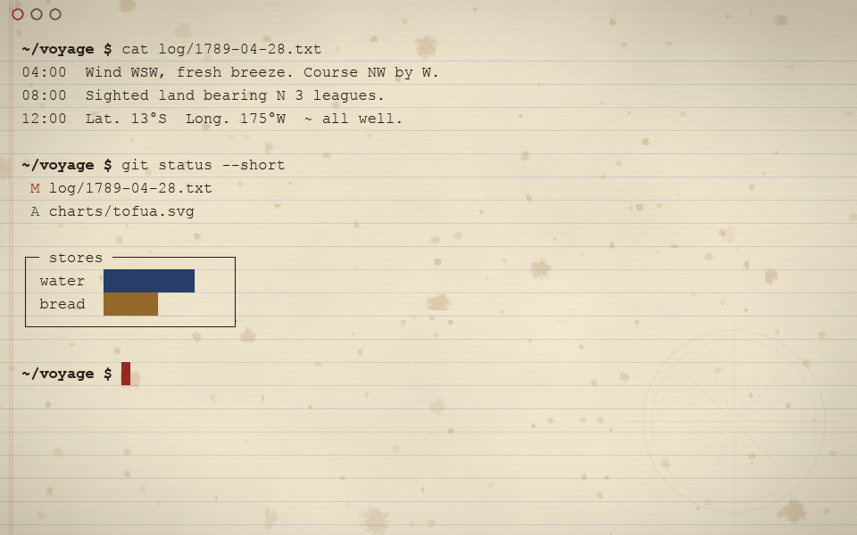
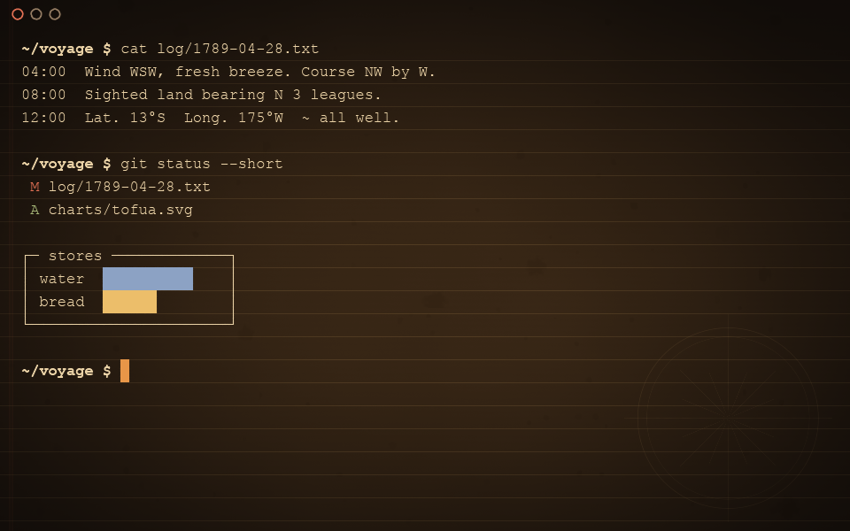

<div align="center">

# oneprompt

**A terminal drawn like an ink painting.**

Text is written in by hand, ink bleeds into hand-made paper,
and deleting a file cuts its name through with a sword.

[](https://github.com/jhasubhash/oneprompt/releases)


[](LICENSE)

<a href="https://www.buymeacoffee.com/subhashjha"></a>

</div>

| Tsushima | Chalkboard | Logbook |
|:---:|:---:|:---:|
|  |  |  |
|  |  |  |
| sumi on washi, after *Ghost of Tsushima* | chalk on slate, charcoal on stone | a ship's log in iron-gall ink |

## Install

```sh
brew install --cask jhasubhash/tap/oneprompt
```

Or grab the dmg from [Releases](https://github.com/jhasubhash/oneprompt/releases). Signed
and notarized, Apple silicon and Intel, macOS 11+. It's an alpha: expect rough edges.

## What it does

| | |
|---|---|
| ✍️ **Written by hand** | New text is traced along each letter's pen path; the ink bleeds, dries and ages. |
| ⚔️ **Strikes what you delete** | `rm` a file and every mention of it on screen is cut through. |
| 🔥 **Undoes what you clear** | `clear` takes the writing back off the page, or burns it away. |
| 🩸 **Marks failures** | A failed command gets a stroke of seal ink; a long one is stamped with a hanko. |
| 📜 **Every theme, its own way** | Openings, theme switches, split dividers, closing panes, the settings panel. |
| 🍁 **Alive when idle** | Leaves fall onto a window left alone; the cursor has a heartbeat. |
| 🖼️ **Pictures and Markdown** | `imgcat photo.png` shows it inline; `md notes.md` shows Markdown styled in the theme's inks. |
| 🖥️ **A real terminal** | Tabs, splits, find with regex, clickable links, IME, true colour, mouse, Claude Code-friendly. |

Every effect can be turned off or tuned in the settings panel (**Cmd+,**) or the settings
file.

## Keys you'll want

| | |
|---|---|
| **Cmd+,** | settings |
| **Cmd+Option+T** | theme picker |
| **Cmd+Shift+L** | light ↔ dark |
| **Cmd+D** / **Cmd+Shift+D** | split side by side / stacked |
| **Cmd+F** | find (**Cmd+R** for regex) |
| **Cmd+K** | clear |
| **Cmd+click** | open a link or file |

## Learn more

- **[The guide](docs/GUIDE.md)**: every theme and effect, all settings and keys, shell
  integration, how themes are built, the code's layout.
- **[Contributing](CONTRIBUTING.md)**: build it, add a theme, send a change.
- **[Security](SECURITY.md)**: reporting a vulnerability.

```sh
cargo run --release          # from source
```

## Support

If oneprompt makes your terminal a nicer place to be, you can
[buy me a coffee](https://www.buymeacoffee.com/subhashjha) ☕

## License

Apache 2.0, copyright 2026 Subhash Jha. Keep the [NOTICE](NOTICE) when you share it.
