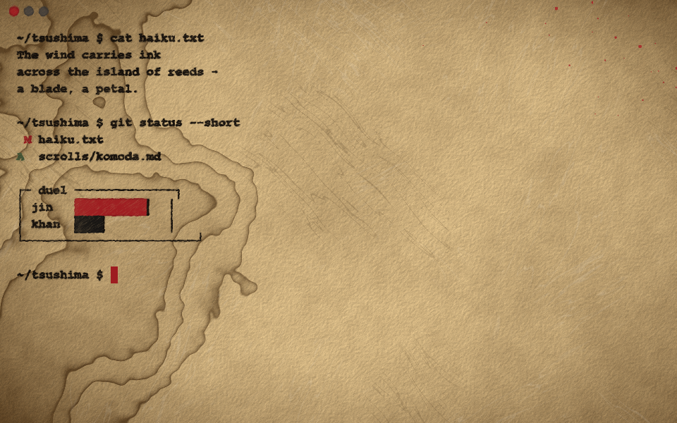
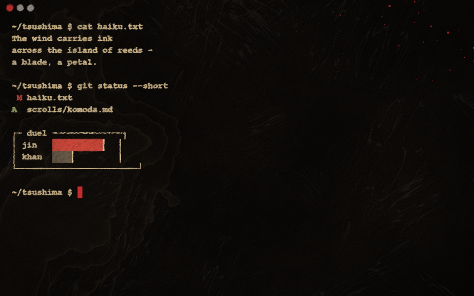

# oneprompt

A GPU terminal (Rust + wgpu) where the surface and the type are part of the design.
No more black rectangle with a generic monospace font: the theme picks a texture,
an ink colour and a typeface.

| Tsushima Light | Tsushima Dark |
|---|---|
|  |  |

## Theme

A theme is the whole look: surface texture, ink behaviour, palette, font and the
window controls. There is one for now, **Tsushima**, after the ink-painting cutscenes of
*Ghost of Tsushima* and *Ghost of Yotei*, in two variants:

- **Light**: golden parchment browning heavily towards the edges, with relief-lit tooth,
  water-stain tide lines, fibers and a flick of crimson splatter; bold near-black sumi swept
  with a slanted brush nib (thick-and-thin strokes, dry-brush streaks, varying pressure)
  whose ragged edges bleed in patches along the fibers; a crimson close control, and a
  cursor that is a dab of cinnabar seal ink (ragged, pressed wider at the top, drying out at
  the bottom, different in every cell).
- **Dark**: the cutscenes inverted: a field of ink with the drawing showing through in
  parchment, the same brushwork, the same seal ink.

### Colours from programs

The 16 ANSI colours come from the theme. Programs that pick exact colours instead
(24-bit truecolor or the 256-colour cube: Claude Code, bat, delta, ...) choose them for a
plain black screen, so on parchment their light greys vanish. oneprompt keeps their hue
but moves their lightness into the range ink can have on the sheet (in OKLab, `color.rs`):
dark inks on light parchment, light inks on the ink field; their backgrounds (prompt rows,
highlighted lines) become thin translucent washes, so the paper shows through. `harmonize_colors = false` shows them exactly as sent. Colour queries (OSC 4, 10,
11, 12) are answered with the theme's real colours, so programs that check can pick their
light or dark palette.

### Ink animation

- **Writing**: new characters are written by hand. Each glyph is traced along a pen path
  derived from its shape (`src/trace.rs`: pieces left to right, each followed along the ink
  from its top-left). Its bleed then keeps creeping into the paper for a few seconds
  (quickly at first, then slowing) while the pen moves on, and every character carries
  its own load of ink, so some bleed more than others. Output that arrives together
  (`ls`, `cat`) is written in reading order, left to right and line by line, at
  `writing_speed` characters per second, sped up so a batch never takes more than 1.5 s.
  Scrolled text keeps its age; full-screen apps and repaints over existing text appear at
  once.
- **Reveals**: the window opens like the cutscenes, parchment torn out of a sheet of ink
  (light) or ink flooding over parchment (dark). Switching light / dark is a sword fight:
  one to five quick slashes (a single sweep, a cross, a claw, a zigzag or a flurry), each
  flinging droplets and edged in seal ink, then the new look runs out of every cut and
  droplet like watercolour on damp paper: quick at first and slowing, its front fingering
  and blooming, pigment pooling in a tide line and settling into the grain, the paper
  ahead darkening as the water reaches it. No two are alike.
- **Deleted names are struck out**: when a file or folder named on screen is deleted (`rm`,
  a script, the Finder, ...), every mention of it, in `ls` output, the command that
  deleted it, anywhere, is cut through with a quick sword stroke in seal ink and fades.
  Words are looked up relative to the shell's working directory; a name that comes back
  is no longer struck. Blood flies off the blade as it cuts, splats and dries to a faint
  stain. `strike_deleted = false` turns it all off, `strike_splatter = false` just the
  blood.
- `animation = false` turns it off, `animation_speed` scales it. The app only redraws while
  something is moving.

The variant follows macOS light / dark mode and switches with it; Cmd+Shift+L flips it for the
session, and `appearance` in the settings pins one. Each switch is brushed in with
brushwork made up on the spot (a few strokes and drops of ink, soaking outward until the
window is covered), so no two look alike. Every session, and every switch, gets a new sheet
of paper (`seed` in the settings or `ONEPROMPT_SEED=<number>` pins one). The renderer still supports the earlier surfaces
(cotton paper, chalkboard, flat) and control styles for themes to come.

Rendering ink is a two-step process: text, line art and controls are drawn into an
offscreen *ink layer*, then `src/shaders/ink.wgsl` composites it onto the surface with
a brush nib (glyphs swept along a slanted nib for thick-and-thin strokes), bleed (ink
wicking along paper fibers), dry-brush grain and pooled rims. The ink also takes on the
sheet's own grain (`absorb`): the brush skips the paper's raised tooth, leaving flecks in
the letters where the sheet shows, ink settles in its hollows and fibers lie over it, all
at the same places the background draws them. Each theme sets those
amounts and its font weight in `theme.rs`; all zero gives crisp screen text.

On macOS the Metal layer is explicitly tagged sRGB. Left untagged, wide-gamut displays
colour-match some frames and not others, which shows up as the window flickering in tint
while you type.

## Status

Milestone 1, a working terminal:

- Your login shell in a PTY, parsed by `alacritty_terminal` (VT sequences, scrollback, alternate screen)
- Grid rendering with glyphon / cosmic-text, one monospace font per theme
- ANSI colours mapped to per-theme palettes ("inks" on paper, "chalks" on slate); 256-colour and true colour pass through
- Bold, italic, underline, strikeout, inverse, dim; block, beam and underline cursors (outlined when unfocused)
- Mouse selection drawn as a per-theme highlighter; double-click selects a word, triple-click a line
- Mouse reporting for full-screen apps (vim, htop, tmux): clicks, drags, wheel, SGR and legacy encodings
- Full-screen apps always get at least 80x24 cells: if the window is too small at the chosen
  font size (btop would refuse to draw), the text shrinks while the app runs (down to half
  size) and returns to normal when it exits
- Box-drawing and block characters drawn as shapes, so borders and bars join without seams
- Focus reporting, left Option as Meta (right Option still types é, €, ...)
- Procedural backgrounds in WGSL (`src/shaders/background.wgsl`): paper fibers and grain, chalkboard smudges and dust, flat

| Key | Action |
|---|---|
| Cmd+, | open settings |
| Cmd+T | new tab (tabs show in the title strip; click one to switch, double-click to rename) |
| Cmd+1 … Cmd+9 | go to tab 1 … 8, Cmd+9 the last |
| Cmd+Shift+] / Cmd+Shift+[ | next / previous tab |
| Cmd+N | new window |
| Cmd+Shift+L | flip between light and dark |
| Cmd+W / Cmd+M | close tab (the window with the last one) / minimize; the theme's controls, top left, close or minimize the window |
| drag top strip | move the window; double-click it to zoom |
| Cmd+= / Cmd+- / Cmd+0 | bigger / smaller / actual-size text |
| Cmd+A / Cmd+K | select all (scrollback too) / clear screen and scrollback |
| right-click | menu: copy, paste, select all, clear, tabs, text size, light / dark, settings (Shift+right-click when an app has the mouse) |
| Cmd+C | copy selection |
| Cmd+V | paste (bracketed when the app asks for it) |
| drag / double / triple click | select text / word / line |
| Shift+drag | select even when an app has taken the mouse |
| left Option+key | Meta (Alt+B, Alt+F, Alt+. ...); Option+←/→ moves by word |
| scroll | scrollback, arrow keys in less/vim, or wheel events if the app wants the mouse |

```sh
cargo run                                       # your login shell
cargo run -- -e "htop"                          # run a command via /bin/sh instead
ONEPROMPT_SNAPSHOT=docs/screenshots cargo run -- -e "..."   # render every theme to PNG and exit
```

To launch it like any Mac app (Spotlight, Launchpad, Dock), make the app bundle once:

```sh
scripts/make-app.sh            # ~/Applications/oneprompt.app; pass another folder to put it there
```

The bundle's executable is a symlink to `target/release/oneprompt`, so it always runs the
latest `cargo build --release`: no need to remake it after changes.

To make a release, `scripts/release.sh` builds a self-contained universal app and a
signed, notarized `target/dist/oneprompt-<version>.dmg` (setup steps are at the top of
the script).

Not yet: IME (composed input for Chinese, Japanese, ...), clickable links, search,
splits.

## Settings

Cmd+, opens `~/.config/oneprompt/config.toml` in your default text editor, creating it
with every option set to its built-in value. Saving applies changes immediately; a
note at the bottom of the window confirms it, or says what is wrong and keeps the previous
settings.

```toml
appearance = "system"         # system | light | dark
animation = true              # hand-written text, window reveals
animation_speed = 1.0
writing_speed = 500           # characters per second for output
harmonize_colors = true       # program-chosen colours as inks on the sheet
strike_deleted = true         # strike out names of deleted files on screen
strike_splatter = true        # with blood flung off the cut
option_as_meta = "left"       # left | both | none
seed = 11                     # pin the paper; unset = new sheet each session

[themes.tsushima-light]       # each variant: fonts, line_height, bleed, nib, grain, edge,
font_family = "Courier New"   # and the paper: texture, stains, splatter (1 = built-in, 0 = off)
font_weight = 700
bleed_variation = 0.5         # per-letter bleed: 0.5 to 1.5 times `bleed`
bleed_time = 4                # seconds the bleed keeps spreading
texture = 0.6
stains = 0
```

The file starts with both variants' built-in values as active lines, so editing a number
just works (`oneprompt --default-config` prints it). Top-level `font_family`, `font_size`
and `font_weight` also exist and apply to any variant whose section doesn't set them.
Font weights snap to the faces the font has (Courier New: 400 and 700); the text engine
would otherwise fall back to a different, proportional font. A font that is missing or not
monospace gets a warning at the bottom of the window. `ONEPROMPT_CONFIG=<path>` uses a different file.

## Layout

```
src/main.rs                 window events, shortcuts, wiring
src/terminal.rs             PTY + alacritty_terminal grid, resize, scroll, paste
src/input.rs                key presses -> xterm byte sequences
src/boxdraw.rs              box-drawing and block characters as rectangles
src/chrome.rs               theme-drawn window controls: layout and hit testing
src/config.rs               settings file: parsing, theme overrides, live reload
src/renderer.rs             ink pass (text, line art, controls), main pass (surface, cells, ink composite), present pass
src/animation.rs            per-cell write times (reading order, scroll-aware) and window reveals
src/strike.rs               names on screen whose files were deleted, to strike out
src/trace.rs                pen paths: per-glyph stroke order for the hand-writing reveal
src/color.rs                program-chosen colours mapped onto the sheet (OKLab)
src/theme.rs                themes as plain data
src/shaders/background.wgsl procedural textures
src/shaders/rect.wgsl       rectangles, brush discs, rings and crosses
src/shaders/ink.wgsl        ink-on-surface composite: nib, bleed, grain, pooled rims, write-in
src/shaders/present.wgsl    window reveal through a growing brush shape, or sword cuts
```

## Roadmap

1. **Proportional and handwritten fonts.** The grid needs a fixed advance, so themes
   use monospace faces today (Courier New, PT Mono, Menlo). Faces like American
   Typewriter or Chalkboard need per-cell glyph placement (centre each glyph in its cell).
2. **Input and navigation.** IME, clickable links, search in scrollback, splits.
3. **Brush typography.** Stroke-width variation (pressure) and per-glyph wobble, a
   brush-style monospace face for Tsushima.
4. **Theme files.** TOML themes with hot reload, image textures (scanned paper, linen)
   alongside procedural ones, and per-role fonts (prompt, output, bold, italic).
5. **Polish.** Cursor styles (nib, chalk stub), selection as highlighter, ligatures, IME.

## License

Copyright 2026 Subhash Jha. Licensed under the [Apache License, Version 2.0](LICENSE).

You may use, change and share the code, but you must give credit: keep the copyright
notices and the [NOTICE](NOTICE) file, say which files you changed, and include the
NOTICE's attribution in what you distribute.
