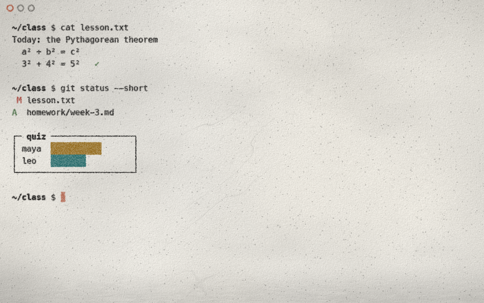
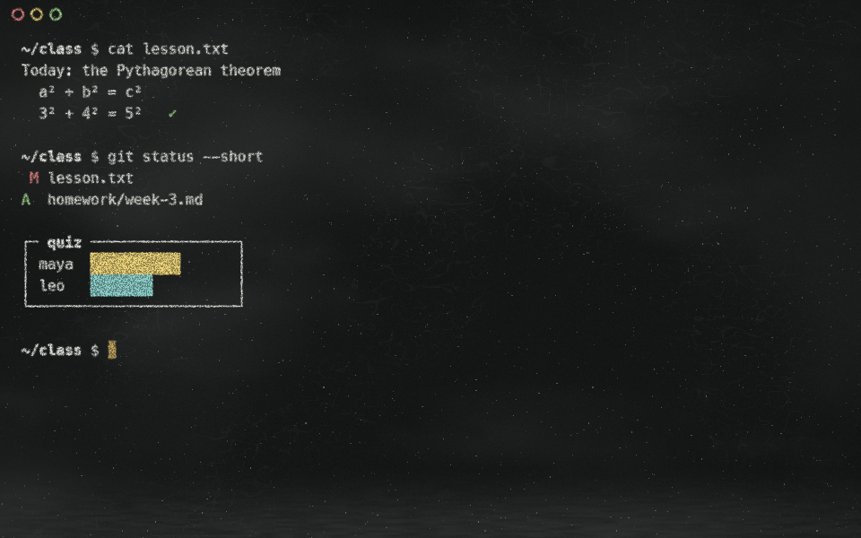

# oneprompt

A GPU terminal (Rust + wgpu) where the surface and the type are part of the design.
No more black rectangle with a generic monospace font: the theme picks a texture,
an ink colour and a typeface.

| Tsushima Light | Tsushima Dark |
|---|---|
|  |  |

| Chalkboard Stone | Chalkboard Slate |
|---|---|
|  |  |

## Install

With [Homebrew](https://brew.sh):

```sh
brew install --cask jhasubhash/tap/oneprompt
```

`brew upgrade --cask oneprompt` updates it, and the `oneprompt` command is on your PATH too
(`oneprompt -e "command"`). Or download the dmg from the
[releases](https://github.com/jhasubhash/oneprompt/releases) and drag oneprompt into
Applications. Either way it is signed and notarized, runs on Apple silicon and Intel, and
needs macOS 11 or later. These are alphas: expect rough edges.

## Themes

A theme is the whole look: surface texture, how ink or chalk behaves on it, palette, font,
cursor, window controls, and its own animations: how the window opens, how the theme takes
over when you switch to it, and how it strikes out deleted names. Each comes in a light and
a dark variant. Cmd+Option+T (or Themes… in the right-click menu) opens the **theme
picker**: a card per theme showing your current screen as that theme draws it, live.
Arrow keys or the pointer choose, Return or a click switches (with the theme's own
transition) and saves it as `theme` in the settings, Esc closes; Cmd+Shift+L still flips
light and dark so both variants can be compared.

**Tsushima**, after the ink-painting cutscenes of *Ghost of Tsushima* and *Ghost of Yotei*:

- **Light**: golden parchment browning heavily towards the edges, with relief-lit tooth,
  water-stain tide lines, fibers and a flick of crimson splatter; bold near-black sumi swept
  with a slanted brush nib (thick-and-thin strokes, dry-brush streaks, varying pressure)
  whose ragged edges bleed in patches along the fibers; a crimson close control, and a
  cursor that is a dab of cinnabar seal ink (ragged, pressed wider at the top, drying out at
  the bottom, different in every cell).
- **Dark**: the cutscenes inverted: a field of ink with the drawing showing through in
  parchment, the same brushwork, the same seal ink.

**Chalkboard**, writing on a well-used board:

- **Stone** (light): dark charcoal on a slab of white stone, softly mottled, its fine grain
  lit from the top left, with tiny pits and a few faint grey veins. Pastel colours for the
  palette, a sanguine cursor.
- **Slate** (dark): chalk on black slate, with years of eraser swirls, faint ghosts of old
  lessons, specks of dust and more of it along the chalk tray. Coloured chalks for the
  palette.
- On both, strokes are broad and grainy where they skip the surface's tooth, dusty at their
  edges, and freshly written letters shed a little more dust that settles. A stub cursor,
  ring controls.

### Colours from programs

The 16 ANSI colours come from the theme. Programs that pick exact colours instead
(24-bit truecolor or the 256-colour cube: Claude Code, bat, delta, ...) choose them for a
plain black screen, so on parchment their light greys vanish. oneprompt keeps their hue
but moves their lightness into the range ink can have on the sheet (in OKLab, `color.rs`):
dark inks on light parchment, light inks on the ink field; their backgrounds (prompt rows,
highlighted lines) become thin translucent washes, so the paper shows through. `harmonize_colors = false` shows them exactly as sent. Colour queries (OSC 4, 10,
11, 12) are answered with the theme's real colours, so programs that check can pick their
light or dark palette.

### Ink animation

- **Writing**: new characters are written by hand. Each glyph is traced along a pen path
  derived from its shape (`src/trace.rs`: pieces left to right, each followed along the ink
  from its top-left). Its bleed then keeps creeping into the paper for a few seconds
  (quickly at first, then slowing) while the pen moves on, and every character carries
  its own load of ink, so some bleed more than others. Output that arrives together
  (`ls`, `cat`) is written in reading order, left to right and line by line, at
  `writing_speed` characters per second, sped up so a batch never takes more than 1.5 s.
  Scrolled text keeps its age; full-screen apps and repaints over existing text appear at
  once.
- **Reveals**: the incoming theme plays its own. Tsushima opens the window like the
  cutscenes, parchment torn out of a sheet of ink (light) or ink flooding over parchment
  (dark), and switching to it is a sword fight:
  one to five quick slashes (a single sweep, a cross, a claw, a zigzag or a flurry), each
  flinging droplets and edged in seal ink, then the new look runs out of every cut and
  droplet like watercolour on damp paper: quick at first and slowing, its front fingering
  and blooming, pigment pooling in a tide line and settling into the grain, the paper
  ahead darkening as the water reaches it. Chalkboard wipes the old look off with an
  eraser, back and forth in a few passes, leaving streaky smears and pushing dust along
  its edge. No two are alike.
- **Deleted names are struck out**: when a file or folder named on screen is deleted (`rm`,
  a script, the Finder, ...), every mention of it, in `ls` output, the command that
  deleted it, anywhere, is struck through and fades. Words are looked up relative to the
  shell's working directory; a name that comes back is no longer struck. Tsushima cuts it
  with a sword that flings blood, which splats and dries to a faint stain; Chalkboard
  draws a quick chalk line that knocks off a little dust. `strike_deleted = false` turns it
  all off, `strike_splatter = false` just the extras (blood, dust).
- **Ink dries and ages**: fresh text is wet for `drying_time` seconds (4): Tsushima's sumi
  is heavier and glossy, the sheen dulling as it dries to matte; Chalkboard's chalk is at
  its brightest and dustiest. Ink that has been on screen a long while fades a little, as
  old ink does (`ink_aging`, 0.3, reached after an hour: Tsushima's browns, chalk greys
  towards the board). `ink_drying = false` and `ink_aging = 0` turn them off.
- **Failed commands are marked**: a command that exits with an error gets the theme's mark
  in the margin beside its prompt, so scrolling back shows where things went wrong.
  Tsushima drags a stroke of seal ink down the margin and a drop of it runs and dries;
  Chalkboard chalks a red cross. Ctrl+C (status 130) is not a failure. It needs shell
  integration (below); `mark_failures = false` turns it off.
- **Long commands are stamped**: when a command that ran at least `stamp_after` seconds
  (10) finishes, it is stamped after the command on its line, so a finished build catches
  the eye. Tsushima brings a hanko down onto the paper with a thud, its characters
  carved out of the seal ink (an empty, slashed seal if it failed); Chalkboard circles it
  and ticks it (a cross if it failed). `stamp_long_commands = false` turns it off.
- `animation = false` turns it off, `animation_speed` scales it. The app only redraws while
  something is moving.

The variant follows macOS light / dark mode and switches with it; Cmd+Shift+L flips it for the
session, and `appearance` in the settings pins one. Every session, and every switch, gets a
new sheet (`seed` in the settings or `ONEPROMPT_SEED=<number>` pins one).

Rendering ink is a two-step process: text, line art, controls, the cursor and strikes are
drawn into an offscreen *ink layer*, then the theme's ink stage composites it onto its
surface. Tsushima's (`src/themes/tsushima/ink.wgsl`) sweeps glyphs along a slanted brush
nib for thick-and-thin strokes, lets the ink bleed along the paper's fibers, adds
dry-brush grain and pooled rims, and lets it take on the sheet's own grain (`absorb`):
the brush skips the paper's raised tooth, ink settles in its hollows and fibers lie over
it, at the same places the surface draws them. Chalkboard's makes chalk of it.

### How themes are built

The app is a framework, and each theme is a module in `src/themes/<name>/` that only uses
the theme API in `src/theme/mod.rs` (a test checks that no theme reaches past it, or into
another theme). A theme implements the `Theme` trait:

- **Variants**: colours, palette, fonts, window controls, and values for its settings.
- **Settings** it declares (name, range, description): the settings file, its template,
  its validation and the theme's rows in the settings panel are generated from them.
- **Stages** in WGSL, each a function the framework calls: `surface` (the sheet),
  `theme_ink` (how the ink layer lands on it, with the framework's hand-writing state and
  each cell's `wetness` and `aged`),
  `theme_shape` (its own shapes: Tsushima's brush dab and sword slash, Chalkboard's chalk
  stick and line) and `theme_transition` (its reveals). Each gets a shared prelude (the
  frame: size, time, seed, grid, colours; and `hash`, `noise`, `rotate`) plus its own data
  from Rust. A stage it leaves out gets a plain default. A test compiles every stage.
- **Events**: `reveal` (the window opens), `switch` (switching to it, from its other
  variant or another theme), `cursor`, `strike` / `draw_strike` (a deleted name),
  `draw_divider` (the line between split panes, drawn in when the split is made), and
  `mark_time` / `draw_failure` (a command that failed, beside its prompt) and
  `stamp_time` / `draw_stamp` (a long command that finished).

Adding a theme is a folder with a `mod.rs` and its shaders, and a line in
`src/themes/mod.rs`. CONTRIBUTING.md has the details.

On macOS the Metal layer is explicitly tagged sRGB. Left untagged, wide-gamut displays
colour-match some frames and not others, which shows up as the window flickering in tint
while you type.

## Status

Milestone 1, a working terminal:

- Your login shell in a PTY, parsed by `alacritty_terminal` (VT sequences, scrollback, alternate screen)
- Grid rendering with glyphon / cosmic-text, one monospace font per theme
- ANSI colours mapped to per-theme palettes ("inks" on paper, "chalks" on slate); 256-colour and true colour pass through
- Bold, italic, underline, strikeout, inverse, dim; block, beam and underline cursors (outlined when unfocused)
- Mouse selection drawn as a per-theme highlighter; double-click selects a word, triple-click a line
- Mouse reporting for full-screen apps (vim, htop, tmux): clicks, drags, wheel, SGR and legacy encodings
- Full-screen apps always get at least 80x24 cells: if their pane (or the window) is too
  small at the chosen font size (btop would refuse to draw), that pane's text shrinks while
  the app runs (down to half size) and returns to normal when it exits; the other panes keep
  theirs
- Splits: panes side by side (Cmd+D) or one above the other (Cmd+Shift+D), each its own
  shell started in the same folder, on one continuous sheet; the panes without the keyboard
  are veiled a little, and the dividers between them can be dragged. Each theme draws its
  dividers in when a split is made: Tsushima cuts them with one stroke of the sword,
  Chalkboard rules them in chalk
- Find (Cmd+F): every match in the scrollback and on screen highlighted, the current one in
  the cursor's colour; Return / Shift+Return (or Cmd+G / Cmd+Shift+G, ↑ / ↓) go to older and
  newer ones, and Esc leaves the current one selected. Lowercase matches either case. Cmd+R
  in the find bar switches to a regular expression (`.*` shows in the bar; one that does not
  parse says so) and back to plain text
- Links: hold Cmd to underline the one under the pointer, Cmd+click to open it. Web
  addresses (also wrapped over two rows), hyperlinks programs mark (OSC 8, as
  `ls --hyperlink` sends) and names of files and folders that exist (`src/main.rs:12` opens
  the file)
- Input methods (IME): Chinese, Japanese, Korean and accents typed as two keys are composed
  at the cursor, underlined, with the system's candidate window beside it
- Box-drawing and block characters drawn as shapes, so borders and bars join without seams
- Focus reporting, left Option as Meta (right Option still types é, €, ...)
- Themes as isolated modules on a common framework (`src/theme`, `src/themes`), with a live
  theme picker

| Key | Action |
|---|---|
| Cmd+, | settings panel (Cmd+O in it: the settings file) |
| Cmd+T | new tab (tabs show in the title strip; click one to switch, double-click to rename) |
| Cmd+1 … Cmd+9 | go to tab 1 … 8, Cmd+9 the last |
| Cmd+Shift+] / Cmd+Shift+[ | next / previous tab |
| Cmd+N | new window |
| Cmd+D / Cmd+Shift+D | split the pane side by side / one above the other (drag a divider to resize) |
| Cmd+Option+arrows, Cmd+] / Cmd+[ | the pane that way, the next / previous pane; a click in a pane also gives it the keyboard |
| Cmd+F | find; Return / Shift+Return older / newer match, Cmd+R regular expression / text, Esc closes |
| Cmd+click | open the link under the pointer (hold Cmd to see it underlined) |
| Cmd+Shift+L | flip between light and dark |
| Cmd+Option+T | theme picker |
| Cmd+W / Cmd+M | close the pane, the tab with its last pane (the window with the last tab) / minimize; the theme's controls, top left, close or minimize the window |
| drag top strip | move the window; double-click it to zoom |
| Cmd+= / Cmd+- / Cmd+0 | bigger / smaller / actual-size text |
| Cmd+A / Cmd+K | select all (scrollback too) / clear screen and scrollback |
| right-click | menu: copy, paste, select all, clear, find, tabs, splits, text size, light / dark, themes, settings (Shift+right-click when an app has the mouse) |
| Cmd+C | copy selection |
| Cmd+V | paste (bracketed when the app asks for it) |
| drag / double / triple click | select text / word / line |
| Shift+drag | select even when an app has taken the mouse |
| left Option+key | Meta (Alt+B, Alt+F, Alt+. ...); Option+←/→ moves by word |
| scroll | scrollback, arrow keys in less/vim, or wheel events if the app wants the mouse |

```sh
cargo run                                       # your login shell
cargo run -- -e "htop"                          # run a command via /bin/sh instead
ONEPROMPT_SNAPSHOT=docs/screenshots cargo run -- -e "..."   # render every theme to PNG and exit
```

To launch it like any Mac app (Spotlight, Launchpad, Dock), make the app bundle once:

```sh
scripts/make-app.sh            # ~/Applications/oneprompt.app; pass another folder to put it there
```

The bundle's executable is a symlink to `target/release/oneprompt`, so it always runs the
latest `cargo build --release`: no need to remake it after changes.

To make a release, `scripts/release.sh` builds a self-contained universal app and a
signed, notarized `target/dist/oneprompt-<version>.dmg` (setup steps are at the top of
the script). Once the dmg is published as a GitHub release, `scripts/update-cask.sh`
points the Homebrew cask ([jhasubhash/homebrew-tap](https://github.com/jhasubhash/homebrew-tap))
at it.

## Settings

Cmd+, (or Settings… in the right-click menu) opens the **settings panel**, a sheet of the
current theme's own surface down the right of the window, so the terminal stays in view
and every change shows as you make it. It has the theme and appearance, the variant on
screen's font, size, weight and line height and its theme's own settings (each theme
brings its own rows: Tsushima's bleed and nib, Chalkboard's grit and dust, ...), then
animation and terminal settings. Arrow keys move between rows and change them (Shift for
fine steps), Return flips a toggle, the pointer clicks and drags, Esc or a click beside it
closes; Cmd+Shift+L shows the other variant's rows.

Everything the panel changes is written to `~/.config/oneprompt/config.toml`, keeping your
comments and layout, and the panel always shows what the file says, so you can use either.
The panel shows where the file is; Cmd+O there (or Edit Settings File… in the menu) opens
it in your default text editor, creating it with every option set to its built-in value.
Saving it applies changes immediately; a note at the bottom of the window confirms it, or
says what is wrong and keeps the previous settings (the panel says so too).

```toml
theme = "tsushima"            # tsushima | chalkboard (the picker sets it)
appearance = "system"         # system | light | dark
animation = true              # hand-written text, window reveals
animation_speed = 1.0
writing_speed = 500           # characters per second for output
harmonize_colors = true       # program-chosen colours as inks on the sheet
strike_deleted = true         # strike out names of deleted files on screen
strike_splatter = true        # with the theme's extras (blood, chalk dust)
ink_drying = true             # fresh ink looks wet, then dries
drying_time = 4               # seconds
ink_aging = 0.3               # how far ink an hour old fades, 0..1
shell_integration = true      # the shell marks its prompts (new shells)
mark_failures = true          # mark failed commands beside their prompt
stamp_long_commands = true    # stamp commands that ran a while when they finish
stamp_after = 10              # seconds a command must run to be stamped
option_as_meta = "left"       # left | both | none
seed = 11                     # pin the paper; unset = new sheet each session

[themes.tsushima-light]       # each variant: fonts and line_height, then the theme's own
font_family = "Courier New"   # settings (Tsushima: bleed, nib, grain, edge, absorb, texture,
                              # stains, splatter; Chalkboard: grit, dust, smudges, ghosts)
font_weight = 700
bleed_variation = 0.5         # per-letter bleed: 0.5 to 1.5 times `bleed`
bleed_time = 4                # seconds the bleed keeps spreading
texture = 0.6
stains = 0
```

The file starts with every variant's built-in values as active lines, each theme's settings
explained above its sections, so editing a number just works (`oneprompt --default-config` prints it). Top-level `font_family`, `font_size`
and `font_weight` also exist and apply to any variant whose section doesn't set them.
Font weights snap to the faces the font has (Courier New: 400 and 700); the text engine
would otherwise fall back to a different, proportional font. A font that is missing or not
monospace gets a warning at the bottom of the window. `ONEPROMPT_CONFIG=<path>` uses a different file.

### Shell integration

Marking commands needs the shell to say where each prompt starts and how each command
ended, with the OSC 133 marks other terminals read too. **zsh** does it without any setup:
oneprompt starts it with `ZDOTDIR` pointing at a small `.zshenv` that puts yours back,
reads your own `.zshenv` and adds two hooks; your other files are read as always.
**fish** 4 sends the marks itself. **bash**: add this to the end of `~/.bashrc`:

```bash
PROMPT_COMMAND='printf "\e]133;D;%s\a\e]133;A\a" $?'"${PROMPT_COMMAND:+;$PROMPT_COMMAND}"
PS0=$'\e]133;C\a'
```

`shell_integration = false` leaves zsh alone (it applies to shells started afterwards).

## Layout

```
src/main.rs                 window events, shortcuts, wiring
src/terminal.rs             PTY + alacritty_terminal grid, resize, scroll, paste
src/input.rs                key presses -> xterm byte sequences
src/boxdraw.rs              box-drawing and block characters as rectangles
src/chrome.rs               theme-drawn window controls: layout and hit testing
src/config.rs               settings file: parsing, theme overrides, edits that keep comments, live reload
src/settings.rs             settings panel: its rows, from the settings and the theme's own, and what changing them writes
src/renderer.rs             the passes and each theme's stages: ink layer, surface + cells + ink a pane at a time, transition; the picker, settings panel, find bar and composed input
src/picker.rs               theme picker: card layout and hit testing
src/animation.rs            per-cell write times (reading order, scroll-aware) and window transitions
src/strike.rs               names on screen whose files were deleted, to strike out
src/marks.rs                shell integration: prompt and command marks (OSC 133) read from the PTY, zsh's setup
src/shell/zshenv            the zsh integration
src/panes.rs                splits: each tab's tree of panes, their boxes, dividers and neighbours
src/search.rs               find: matches in the scrollback, the current one, scrolling to it
src/links.rs                links under the pointer: web addresses, OSC 8 hyperlinks, existing files
src/trace.rs                pen paths: per-glyph stroke order for the hand-writing reveal
src/color.rs                program-chosen colours mapped onto the sheet (OKLab)
src/theme/mod.rs            the theme API: Theme, Variant, settings, shapes, plans, hooks
src/themes/mod.rs           the list of themes, and the isolation test
src/themes/tsushima/        washi and sumi: surface, ink, shapes, brushwork and sword transitions
src/themes/chalkboard/      slate and chalk: surface, chalk, shapes, eraser transitions
src/shaders/prelude.wgsl    shared by every stage: the frame, noise
src/shaders/*_stage.wgsl    the framework's part of each stage; *_default.wgsl its plain defaults
src/shaders/image.wgsl      picker previews
```

## Roadmap

1. **Proportional and handwritten fonts.** The grid needs a fixed advance, so themes
   use monospace faces today (Courier New, PT Mono, Menlo). Faces like American
   Typewriter or Chalkboard need per-cell glyph placement (centre each glyph in its cell).
2. **Input and navigation.** IME, clickable links, search in scrollback, splits.
3. **Brush typography.** Stroke-width variation (pressure) and per-glyph wobble, a
   brush-style monospace face for Tsushima.
4. **More themes.** Image textures (scanned paper, linen) alongside procedural ones,
   and per-role fonts (prompt, output, bold, italic).
5. **Polish.** Selection as highlighter, ligatures, IME.

## License

Copyright 2026 Subhash Jha. Licensed under the [Apache License, Version 2.0](LICENSE).

You may use, change and share the code, but you must give credit: keep the copyright
notices and the [NOTICE](NOTICE) file, say which files you changed, and include the
NOTICE's attribution in what you distribute.
