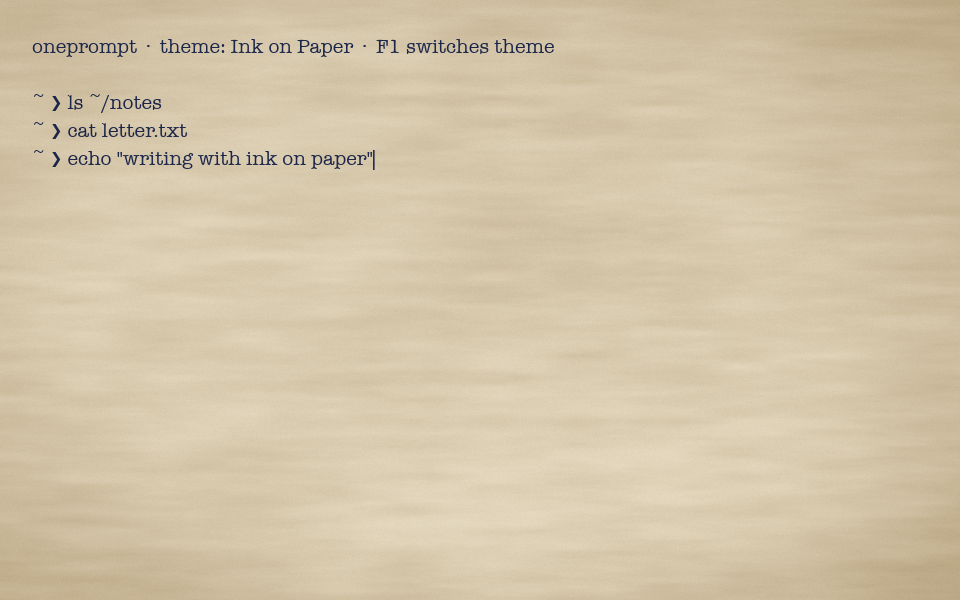
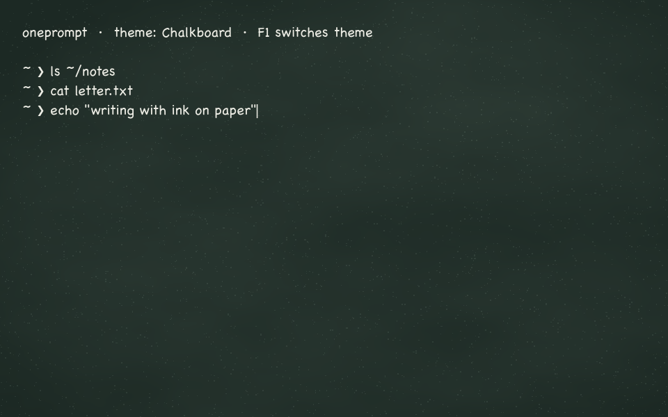
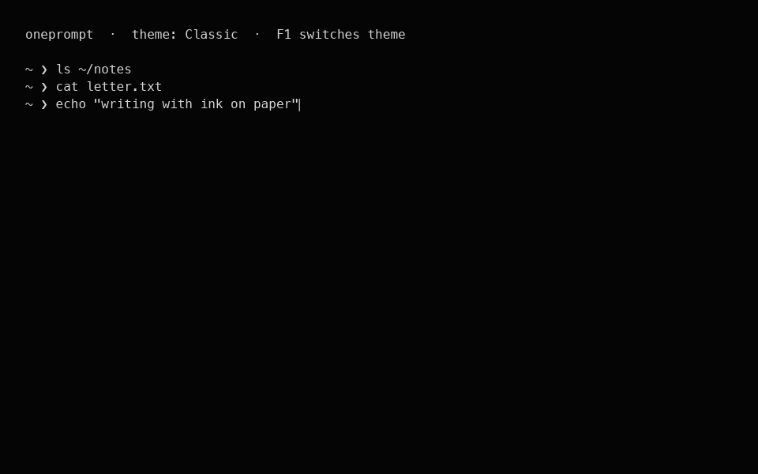

# oneprompt

A GPU terminal (Rust + wgpu) where the surface and the type are part of the design.
No more black rectangle with a generic monospace font: themes pick a texture,
an ink colour and a typeface, for example *ink on paper* or *chalk on slate*.

| Ink on Paper | Chalkboard | Classic |
|---|---|---|
|  |  |  |

## Status

Milestone 0, a rendering prototype:

- winit window + wgpu renderer
- Procedural backgrounds in WGSL (`src/shaders/background.wgsl`): paper fibers and grain, chalkboard smudges and dust, flat
- Per-theme fonts via glyphon / cosmic-text (system fonts, fallback included)
- A local line editor so you can type and see the feel. **There is no shell yet.**

```sh
cargo run                                   # F1 cycles themes
ONEPROMPT_SNAPSHOT=docs/screenshots cargo run   # render every theme to PNG and exit
```

## Layout

```
src/main.rs                 app + input handling (winit ApplicationHandler)
src/renderer.rs             wgpu setup, background pass, text pass, PNG snapshots
src/theme.rs                themes as plain data
src/shaders/background.wgsl procedural textures
```

## Roadmap

1. **Real terminal.** Spawn the shell with `portable-pty` and parse output with
   `alacritty_terminal` (grid, scrollback, VT parser). Swap the line editor for the grid.
2. **Cell grid renderer.** Fixed cell metrics from the theme's font. Proportional
   faces such as American Typewriter look lovely but break column alignment, so themes
   should prefer monospace faces (Courier Prime, iA Writer Mono, Victor Mono, Comic Mono)
   or fall back to per-cell glyph placement.
3. **Ink shader.** Render text to an offscreen texture, then composite it with the paper:
   multiply blending, slightly darker glyph edges, and noise-driven pressure and bleed
   so letters look absorbed rather than printed on top.
4. **Theme files.** TOML themes with hot reload, image textures (scanned paper, linen)
   alongside procedural ones, and per-role fonts (prompt, output, bold, italic).
5. **Polish.** Cursor styles (nib, chalk stub), selection as highlighter, ligatures, IME.
